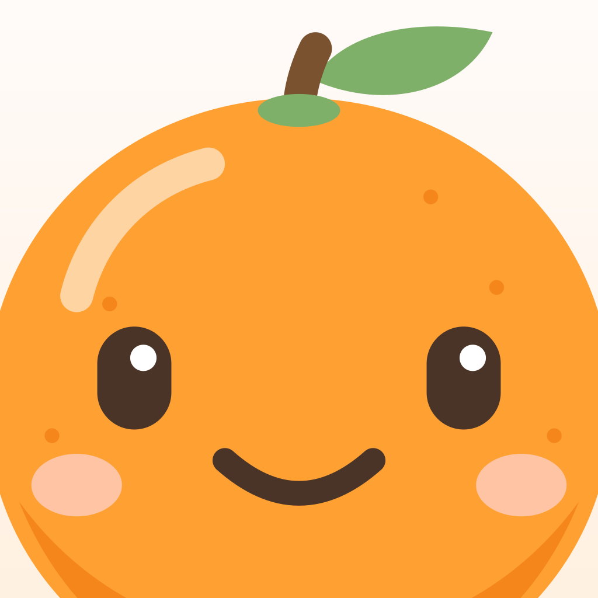

  

<h1 align="center">Calmera – AI calorie and macro tracker</h1>

  <a href="https://yufengwu.dev/calmera/">Website</a> ·
  <a href="mailto:calmeradev@gmail.com">Support: calmeradev@gmail.com</a>

Calmera is a free, open-source calorie and macro tracker for iPhone. Type, say or snap a photo of a meal, and your own AI estimates its calories, protein, carbs and fat.

## Core features

1. **Powered by your own AI.** Sign in with ChatGPT to use your existing plan, or use an OpenAI or Anthropic API key. Every estimate runs on your own AI, and Calmera itself is free, with no subscription fee.
2. **Pick your model,** such as Sonnet, Opus or Haiku, with optional online search for restaurants and brands.
3. **No account.** No sign-up, and all your data stays on your iPhone.
4. **Log by text, voice or photo.**

## Repo organization

| Folder | What's in it |
| --- | --- |
| `app/` | The Expo / React Native project: `package.json`, the Expo and EAS config, `ios/` (the Xcode project), `modules/calmera-chatgpt/` (Calmera's native code: ChatGPT sign-in, the Liquid Glass controls and tab bar, and the photo picker), `assets/`, `scripts/` and `tests/` |
| `app/src/app/` | The screens, one file per route ([Expo Router](https://docs.expo.dev/router/introduction/)) |
| `app/src/components/` | UI, with a folder for each feature: `today`, `meals`, `voice`, `insights`, `goals`, `settings`, `privacy` and `brand` |
| `app/src/lib/` | Logic without UI, most of it covered by `app/tests/`: AI connections and estimates, ChatGPT sign-in, storage on the iPhone, Insights statistics |
| `app/src/hooks/`, `app/src/constants/`, `app/src/context/` | React hooks, design tokens and app-wide state |
| `docs/` | Development, release, privacy and design notes |
| `archive/` | Features the app no longer uses, kept for reference |

## Contribute

Bug reports and ideas are welcome. [Open an issue](https://github.com/yufeng-wu/calmera/issues) or email [calmeradev@gmail.com](mailto:calmeradev@gmail.com).

To run Calmera yourself, you need a Mac with Node.js 22, CocoaPods and Xcode 26. Setup, tests and release steps are in [docs/README.md](docs/README.md), and every command runs from `app/`.

For larger changes, please open an issue first so we can agree on the approach. By submitting a pull request, you agree that your contribution is licensed under the GPL-3.0 and that Yufeng Wu may also ship it in the App Store version of Calmera.

## License

Calmera is open source under the [GNU General Public License v3.0](LICENSE). [NOTICE](NOTICE) adds a few terms: keep the attribution, and give modified versions their own name and icon. The Calmera name, logo and app icon aren't covered by the GPL.

Copyright (C) 2026 Yufeng Wu.
